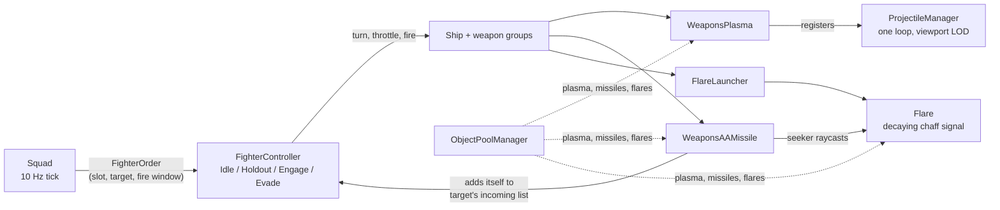

# Blue Baron: Gameplay Systems Showcase

Blue Baron is a 2D top-down space combat game I'm building as a solo dev in Unity 6.3 (URP, VFX Graph, Shader Graph). At its current state, hundreds of AI
fighters fly in squads, dogfight, launch radar-guided missiles and drop flares to decoy them. I made the art and VFX
myself.

This repo is a curated excerpt of the game's C#, about 2,800 of its roughly 6,000 lines, picked to show the
systems I'm proudest of. The full project is private as I plan a commercial release at some point, so there are no scenes, prefabs,
art or project settings here, and the code won't build on its own. I'm happy to walk through the full source upon
request.

<!-- TODO(owner): hero GIF of a large battle, e.g.  -->

## At a glance

| System | What it shows | Files |
|---|---|---|
| [Projectiles without physics](#1-projectiles-without-physics-bodies) | One update loop for every bolt, swept hit tests, viewport LOD | `ProjectileManager`, `IManagedProjectile`, `ManagedProjectile`, `WeaponsPlasma` |
| [Pooling](#2-object-pooling-and-the-bugs-it-hides) | Zero-allocation combat, prewarming, state reset on reuse | `ObjectPoolManager` and every pooled type |
| [Missile guidance](#3-missile-guidance-and-countermeasures) | Proportional navigation, a radar seeker with search and track modes, chaff | `WeaponsAAMissile`, `Flare`, `FlareLauncher` |
| [Squad AI](#4-squad-and-fighter-ai) | Formation flying, target distribution, staggered volleys, missile evasion | `Squad`, `FighterController`, `AIControllerBase` |
| [Profiling tools](#5-profiling-tools) | Editor tools that turn Unity Profiler captures into numbers | `ProfileCaptureAggregator`, `PlasmaLodDebugMenu` |

## How it fits together

## 1. Projectiles without physics bodies

Each plasma bolt was originally a GameObject with a `Rigidbody2D`, a collider and its own `Update`. Big battles
can put thousands of bolts in the air within a second, and that per-object cost adds up fast.

My current solution:
- [`IManagedProjectile`](Assets/Scripts/Ship%20Scripts/Weapons/IManagedProjectile.cs) is a small contract with a position,
  `Step(dt)` and `Despawn()`. [`ProjectileManager`](Assets/Scripts/Game%20Management/ProjectileManager.cs) drives every
  bolt from one `Update` over a flat list. Removal is a swap with the last element, so it's O(1), and the loop runs
  backwards so a swapped-in bolt is never skipped or stepped twice.
- [`WeaponsPlasma`](Assets/Scripts/Ship%20Scripts/Weapons/WeaponsPlasma.cs) has no physics body. Each step sweeps a
  `CircleCast` along the distance it travels that frame, so fast bolts can't tunnel through a ship.
- Viewport LOD: bolts outside the camera (plus an arbitrary margin) step at 10 Hz instead of every frame.
  The sweep covers the whole interval, so a low-rate bolt still can't miss a hit, it just checks less often.
  Impact VFX are skipped off-screen too.
- Verification by debugging: [`PlasmaLodDebugMenu`](Assets/Editor/PlasmaLodDebugMenu.cs) can tint bolts by LOD tier and
  show a live count. It can also invert the tiers as a positive control. Once enabled on-screen bolts visibly stutter,
  which shows the LOD is really running and isn't a no-op.

<!-- TODO(owner): before/after profiler numbers for the bolt pass, if you have them -->

## 2. Object pooling, and the bugs it hides

[`ObjectPoolManager`](Assets/Scripts/Game%20Management/ObjectPoolManager.cs) wraps Unity's `ObjectPool<T>` with one
pool per prefab. It prewarms each pool to the expected peak, so combat reuses objects instead of calling
`Instantiate` mid-fight and increasing load during high bursts of bolt spawning. For prewarming I took out all N objects before returning any. Otherwise returning each one inside
the same loop just gets the same object back every time and leaves the pool at 1. Plasma, missiles and flares were
moved onto pools one at a time, and each move removed the `Instantiate` spikes that type caused.

Most of the work was in the reuse bugs. A pooled object carries state from its last life:
- A missile's trail rendererstill held points from where it died, which drew a streak across the map on the next
  launch. Fixed with `TrailRenderer.Clear()` in `Setup`.
- A recycled flare never becomes `null`, so a missile still locked on it would follow it to its new spawn point.
  The seeker now drops any target that is no longer `activeInHierarchy`.
- Several trigger contacts in one physics step could return a missile to the pool twice. A `live` flag guards it.
- A pooled bolt could re-enter the manager with a stale LOD timer. Registering now resets it.

## 3. Missile guidance and countermeasures

The idea here was to make missile guidance decently complex while still allowing ships to dodge with proper timing of chaff/flare dispensing. I plan on adding other types of both more complex and simpler guidance in the future. The current implementation is what I consider the baseline.

I also wanted to establish a bit of radar detection as a test, as I plan to have more interactions with radar and thermal signals for both ships and missiles for complex emergent gameplay.

[`WeaponsAAMissile`](Assets/Scripts/Ship%20Scripts/Weapons/WeaponsAAMissile.cs) flies in phases:

1. Launch: straight pursuit with a turn rate that ramps up, until the missile points within 10° of the target.
2. Proportional navigation: lateral acceleration `a = N · Vc · λ̇`, where N is the navigation gain, Vc the closing
   speed and λ̇ how fast the line of sight is rotating. It's clamped, and scaled by the current speed, so the turn rate
   is the same at any speed. Steering only changes direction, never speed.
3. Fuel: thrust and steering both burn one fuel budget. When it runs out, the missile coasts ballistically.

The radar seeker behaves like a scanning radar rather than a perfect homing signal:
- Search mode sweeps a ±45° beam back and forth, raycasting for contacts.
- Track mode re-checks the target 15 times a second, aimed at its predicted position. Between checks the missile
  steers toward that prediction. If the target leaves the beam for 3 s, the lock drops. If the predicted point ends up
  behind the missile, it coasts instead of looping back.
- Chaff/flares: each [`Flare`](Assets/Scripts/Ship%20Scripts/Combat%20Systems/Flare.cs) gives off a radar signature that
  fades over its life. The seeker switches to any contact stronger than its current one, then holds the new lock for
  0.5 s so it doesn't flip back and forth between targets.

Missiles add themselves to their target's incoming missile list, which is how the AI knows it's being shot at.

## 4. Squad and fighter AI

With my experience handling "dumb" AI in RTS and strategy games I've played, I wanted to avoid common issues I found annoying (such as micromanaging units to keep them alive from obvious threats). This of course comes with the downside of complexity and thus harder performance optimization, so I've had to rework the AI multiple times.

[`Squad`](Assets/Scripts/Squads/Squad.cs) coordinates the fighters, and
[`FighterController`](Assets/Scripts/Controllers/FighterController.cs) flies each one. Both tick at 10 Hz with a
random offset, so 1,000 agents don't all think on the same frame and cause stuttering. A slow frame drops a tick instead of making
everyone catch up together.

Squad (every tick):
- Every enemy within the engagement radius counts as "in this fight". The same radius works as a leash, so a fighter
  that chases too far is recalled.
- Each fighter is assigned the nearest enemy, but each enemy takes at most `ceil(members / enemies)` attackers, so a
  squad spreads its fire instead of piling onto one target.
- When nothing is in range, the squad flies a vee formation on its leader. If the leader dies, the next fighter
  takes over. The player's ship can also lead a squad.
- Staggering: fighters break formation up to 0.15 s apart, and each member's first missile fires 0.25 s after the
  previous one, so attacks don't land all at once or become defeated by one enemy's flare/chaff activation.

FighterController is a mode switch over an order from the squad:
- Holdout: fly to the formation slot, matching the squad's speed and adding a correction for how far ahead of or
  behind the slot it is.
- Engage: turn toward the target in proportion to the angle, which avoids overshooting at a 10 Hz tick. Fire with
  lead aiming. If the distance to the target barely changes for a while (two ships circling each other forever), it
  does a break turn to get out of the loop.
- Evade (takes priority over the others): flee along the average direction away from incoming missiles, weighted
  by how close each is, with a random jink. Drop flares when its tail faces the threat, or right away if a missile is
  very close.

The AI started as a finite-state machine, moved to Unity's Behavior Graph, and now runs as this plain C# controller after profiling on a lower end device.

## 5. Profiling tools

[`ProfileCaptureAggregator`](Assets/Editor/ProfileCaptureAggregator.cs) is an editor tool I wrote because clicking
through the Profiler window doesn't scale. It loads a saved `.data` capture and walks every frame's sample tree. It
reports median, p95 and max time for each profiler marker, and can print the median-cost or worst-cost frame as a
call tree. When picking the worst frame, it subtracts the profiler's own capture overhead so a screenshot hitch isn't
mistaken for a game problem. It can also print a timeline of chosen markers to show when the 10 Hz ticks bunch
together.

<!-- TODO(owner): a short "how I found X" story with real numbers from a capture -->

## About this repo

- File paths match the private project, so any file here sits in the same place in the full game.
- Some types these files use, such as `ShipBase`, `WeaponGroup`, `Hardpoint` and `SceneManager`, live in the private
  project and aren't included.
- Shown for evaluation only. All rights reserved, see [LICENSE](LICENSE).
